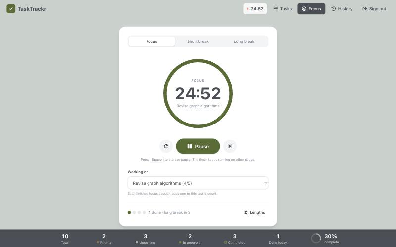
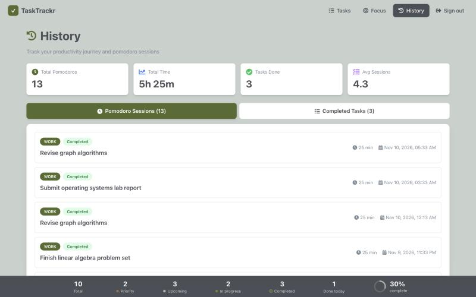

# TaskTrackr

A Kanban board with a Pomodoro timer built in. Plan the work in four columns, pick a task, and work through it one focused session at a time; every session is counted against its task and kept in your history.

[](https://github.com/Deftsalt-debug/TaskTracker/actions/workflows/verify.yml)


## What it does

| | |
|---|---|
| **Board** | Four columns: Priority, Upcoming, In Progress and Completed. Drag cards between them with a mouse, touch or the keyboard. Moving a card into Completed marks it done and timestamps it. |
| **Task cards** | Priority, a due date worded by urgency ("Due tomorrow", "3 days overdue"), and a bar showing focus sessions done against the estimate. |
| **Search and shortcuts** | Filter the board as you type. Press `/` to search and `N` for a new task. |
| **Focus timer** | Focus, short break and long break, with a long break after every fourth focus session. Lengths are adjustable. Press `Space` to start or pause. |
| **A timer that keeps time** | The timer stores when it ends rather than counting down, so it stays accurate in a background tab, keeps running while you use other pages, and survives a reload. The time left shows in the navigation bar and the browser tab title. |
| **History** | Every session and completed task, with totals. |
| **Accounts** | Sign up and sign in, or open a **demo workspace**: a throwaway account filled with sample tasks, no sign-up needed. |

| Focus timer | History |
|---|---|
|  |  |

## Run it

You need **Node.js 22.13 or newer**. There is no database to install: the server uses Node's built-in SQLite and creates its file on first run.

```bash
git clone https://github.com/Deftsalt-debug/TaskTracker.git
cd TaskTracker
npm run setup
npm run dev
```

Open [localhost:5173](http://localhost:5173) and choose **Explore a demo workspace**, or create an account.

`npm run dev` starts the API on port 8080 and the Vite dev server on port 5173. To use it from a phone on the same Wi-Fi, run `npm run dev --prefix frontend -- --host` instead of the frontend half and open the address Vite prints.

### As a single server

```bash
npm run build
SESSION_SECRET="$(openssl rand -hex 32)" npm start
```

The API then serves the built app as well, on [localhost:8080](http://localhost:8080).

### Configuration

All optional, read from the environment by the backend:

| Variable | Default | Purpose |
|---|---|---|
| `PORT` | `8080` | Port the API listens on. |
| `SESSION_SECRET` | random at start-up | Signs session tokens. Without it everyone is signed out when the server restarts. Required (32+ characters) when `NODE_ENV=production`. |
| `DATABASE_PATH` | `backend/data/tasktrackr.db` | Where the SQLite file lives. |
| `CORS_ORIGIN` | `http://localhost:5173` | Comma-separated origins allowed to call the API from a browser. |

## How it is built

| Layer | Implementation |
|---|---|
| Interface | React 18, React Router, Tailwind CSS, dnd-kit for drag and drop, Framer Motion |
| Build | Vite; `/api` is proxied to the backend in development |
| API | Express, in [`backend/src/app.js`](backend/src/app.js) |
| Data | SQLite through `node:sqlite`; schema in [`backend/src/db.js`](backend/src/db.js) |
| Timer | Pure functions in [`frontend/src/timer/engine.js`](frontend/src/timer/engine.js), held app-wide by a React context |

```
backend/
  src/app.js      routes, validation
  src/auth.js     session tokens, sign-in rate limit
  src/db.js       SQLite connection and schema
  src/demo.js     sample data for the demo workspace
  test/           API tests (node:test)
frontend/
  src/pages/      Tasks, Focus, History, sign-in
  src/components/ board, cards, task form, navigation
  src/timer/      timer engine and provider
  test/           timer and date tests (node:test)
docs/
  API.md          endpoint reference
  workshop/       the React workshop this project started as
```

### Security model

- Passwords are hashed with bcrypt and never returned by the API.
- Signing in returns a token: the user id and an expiry, signed with HMAC-SHA256 under `SESSION_SECRET`. It lasts seven days and is sent as a `Bearer` header.
- Every task and session query is scoped to the user in the token. A request cannot name another user's id, and another user's task returns 404.
- Sign-in, sign-up and demo routes are rate limited per address.
- The token is kept in `localStorage`, which is simple but readable by any script on the page. That is a reasonable trade for a learning project; a production app would use an `HttpOnly` cookie.

## Tests

```bash
npm test
```

Runs the API tests against an in-memory database (sign-in, validation, per-user isolation, the demo workspace) and the unit tests for the timer engine and date wording. `npm run verify` adds a production build; [GitHub Actions](.github/workflows/verify.yml) runs it on every push.

## Background

TaskTrackr began as the project for a React workshop: attendees filled in routing, state and API calls in a prepared app. The handout and reference solutions are kept in [`docs/workshop`](docs/workshop); they describe the original Create React App version and its file layout, not the current code.
