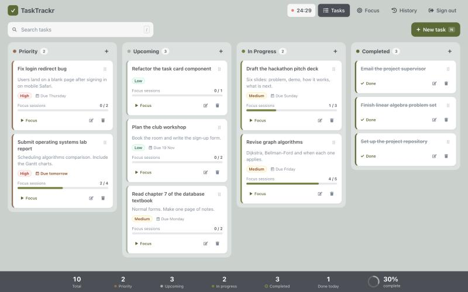

# TaskTrackr

A Kanban task board with a persistent Pomodoro timer, account-based task storage and focus-session history.

**Live demo:** not deployed; run the local demo workspace below.



## What it does

- Creates and moves tasks across Priority, Upcoming, In Progress and Completed.
- Tracks due dates, priorities and estimated/completed focus sessions.
- Runs adjustable focus/break timers that survive navigation and reloads.
- Keeps a history of completed tasks and focus sessions.
- Offers sign-in and a disposable demo workspace populated with sample tasks.

## Run locally

Use Node.js 22.13 or newer; SQLite is built into Node, so no database service is needed.

```bash
git clone https://github.com/Deftsalt-debug/TaskTracker.git
cd TaskTracker
npm run setup
npm run dev
```

Open [localhost:5173](http://localhost:5173) and choose **Explore a demo workspace**, or create an account.
For a single server, run `npm run build` then `npm start`; Express serves the app on port 8080.
See [local configuration](docs/LOCAL_DEVELOPMENT.md) before using production mode.

## Tests

```bash
npm run verify
```

Runs the API tests, timer/date unit tests and frontend production build. CI runs the same checks on pushes and pull requests.
The tests cover authentication, input validation, user isolation, demo data and timer/date behavior.
Lint and static type-check tooling are not configured; these checks are not claimed as passing.

## Architecture

| Layer | Implementation |
| --- | --- |
| Interface | React, React Router, Tailwind, dnd-kit, Framer Motion |
| Build | Vite; development requests to `/api` proxy to Express |
| API | Express routes and validation in `backend/src/app.js` |
| Storage | Node's built-in SQLite; schema in `backend/src/db.js` |
| Authentication | Signed session tokens; password hashing with bcrypt |
| Timer | Pure engine functions plus an app-wide React context |

See [architecture and API reference](docs/ARCHITECTURE.md).

## Known limits

Tokens are stored in browser localStorage; scripts on the page can read them. This is a learning project, not a hardened account service.
SQLite needs a persistent filesystem if records must survive host restarts. A missing stable session secret signs everyone out on restart.
There is no password-recovery flow or deployed demo. Automated tests do not replace browser accessibility and multi-device testing.
Repository `TaskTracker`, package `tasktrackr` and product `TaskTrackr` retain their existing names pending the maintainer's decision.

## Licence

No licence has been added. This project has another contributor; licensing requires the maintainer's decision.

## Credits and project origin

The original workshop project was a collaboration with [Anshul-0211](https://github.com/Anshul-0211).
This is a rebuild by [Deftsalt-debug](https://github.com/Deftsalt-debug): signed sessions and user-scoped queries, the built-in SQLite backend, demo workspace, CRA-to-Vite migration, persistent timer, board redesign, tests and CI.
The original workshop handout and reference solutions are retired; their history remains in Git.
The rebuild's existing Claude co-author trailer and all original author/AI attribution remain unchanged in commit history.
